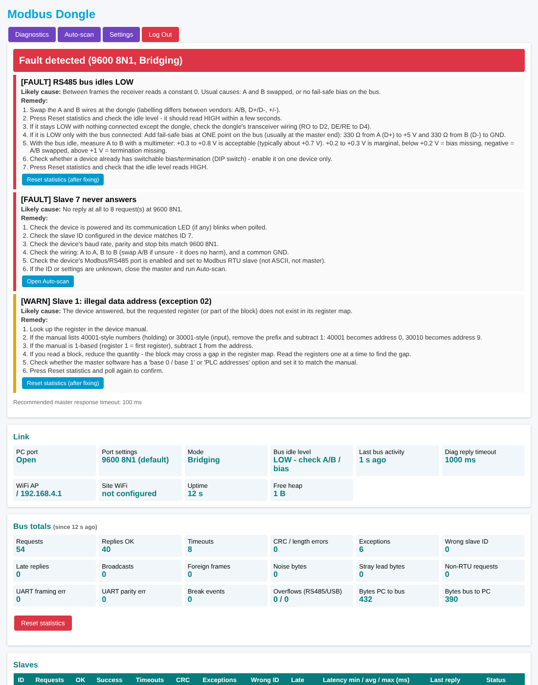
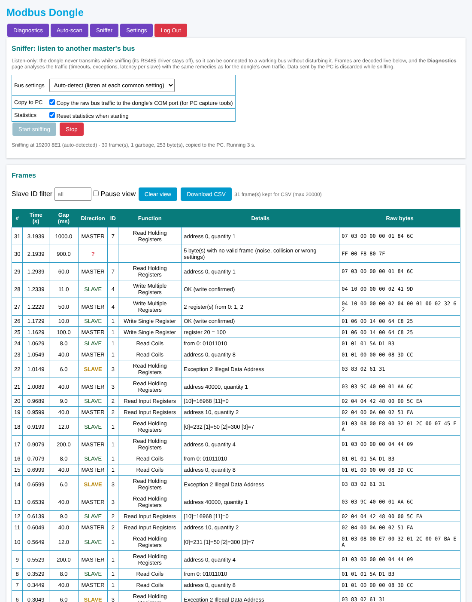

# USB ⇄ RS485 (Modbus RTU) Dongle with Bus Diagnostics — Arduino Nano ESP32

Firmware that turns the **ESP32 Modbus Gateway board** (from
[brahmadeomk/Gateway](https://github.com/brahmadeomk/Gateway)) into a transparent
USB-to-RS485 converter, like a Waveshare *USB TO RS485* dongle. Plug it into a PC
and it shows up as a normal COM port (`COMx` on Windows, `/dev/ttyACM0` on
Linux, `/dev/cu.usbmodem*` on macOS). Any Modbus RTU master software — Modbus
Poll, QModMaster, pymodbus, SCADA drivers, VFD/meter setup tools — then talks
through it to the RS485 bus.

Unlike a plain dongle, it also **watches every transaction it carries and
explains what is wrong with the bus** on a WiFi web page. It can also
**auto-scan** for devices whose baud rate, parity or slave ID you don't know,
and **sniff** (listen only) a bus that another master is already running.

The hardware doesn't change. The firmware uses the same pins and the same
RS485 handling as the Gateway firmware.

## Hardware (same as the Gateway)

| Function | Pin(s) | Used by the dongle |
|---|---|---|
| RS485 (Modbus RTU) | RX = D2, TX = D3, DE/RE = D4 | **Yes**: Serial1, DE/RE controlled automatically |
| Cellular modem UART | D5 / D6 | No |
| Modem PWRKEY | A5 | Held at its idle level (HIGH), no power-on pulse |
| Digital Out 1–4 | D11, D12, D13, A4 | Driven LOW (off) so relays stay off |
| Digital In / Analog In | D7–D10 / A0–A3 | No |
| WiFi | Onboard | Access Point for the diagnostics page, plus optional site WiFi |
| USB-C | — | PC link (USB CDC) |

### RS485 bus bias and termination

| Item | Value |
|---|---|
| Fail-safe bias (at **one** point on the bus) | **330 Ω** from A (D+) to +5 V, and **330 Ω** from B (D-) to GND |
| Termination, dongle end | **120 Ω fitted on the dongle board.** Nothing to add at this end |
| Termination, sensor end | **120 Ω across A-B at the last device at the far end of the cable.** Fit a resistor or switch on the device's termination DIP switch. **Check this on every installation** |
| Termination elsewhere | None. Devices in the middle of the cable must have termination switched off |
| Idle voltage A-B (bus powered, no traffic) | **Acceptable +0.3 V to +0.8 V** (measured about +0.7 V on our setup) |

**Check the sensor-end termination** with everything powered off, by measuring
the resistance between A and B at the dongle. The 330 Ω bias resistors make
the reading a little lower than the plain parallel value:

| Resistance A-B (power off) | Meaning |
|---|---|
| About 50-65 Ω | Correct: dongle end + sensor end terminated |
| About 100-120 Ω | **Sensor-end termination missing.** Only the dongle's 120 Ω is present |
| Below about 45 Ω | Too many terminators: a device in the middle has its termination switched on |

Measure the idle voltage with a multimeter, red lead on A and black lead on B:

| Reading | Meaning |
|---|---|
| Above about +1 V | **Termination missing.** Check the sensor-end 120 Ω (resistance check above) and that the dongle's on-board 120 Ω is connected |
| **+0.3 V to +0.8 V** | **Acceptable.** Bias and termination are fine. The exact value depends on the supply and on how many terminators are fitted (about +0.7 V measured on our setup) |
| +0.2 V to +0.3 V | **Marginal.** It still works, but there's little noise margin. Check that 120 Ω is fitted only at the dongle and the sensor end, and that bias is fitted at one point only |
| Below +0.2 V, or near 0 V | **Fault: bias missing or not powered.** RS485 receivers can't tell idle from data below +0.2 V |
| Negative (about -0.3 V to -0.8 V) | **Fault: A and B swapped** |

The diagnostics page checks the same thing from the receiver side. *Bus idle level: HIGH* matches a reading in the acceptable range; LOW matches a negative reading or missing bias.

## Converter features

- **Follows the host's port settings.** The baud rate, data bits (5–8), parity
  (N/E/O) and stop bits (1/2) that the PC application opens the COM port with
  are applied to the RS485 UART, the same way a CH343/FT232 dongle behaves. If
  the host never sets them, the port defaults to **9600 8N1**.
- **Automatic DE/RE direction control**, using the Gateway's proven timing:
  - a 300 µs driver settle after DE goes high
  - `flush()` waits until the last stop bit has been sent
  - DE is released straight away, inside a critical section, so the slave's
    reply is never cut off
- **Modbus T3.5 inter-frame silence** is enforced before each transmission.
  It's computed from the live baud rate with the same formulas as the Gateway.
- **Byte-transparent.** Works for Modbus RTU, Modbus ASCII and other
  half-duplex RS485 protocols. The diagnostics only **observe** the traffic:
  nothing is changed, delayed, retried or filtered.
- **Low latency.** Replies are passed to USB as soon as the bytes arrive. If a
  request arrives split across USB packets, DE stays asserted until the whole
  request has been sent.
- **Same task layout as the Gateway.** The RS485 bridge runs alone on core 1.
  WiFi and the web server run on core 0, so web activity can never delay the
  bus.
- **RGB LED status** (the USB port carries only data, never debug text):

  | LED | Meaning |
  |---|---|
  | White flash | Booted |
  | Blue flash | PC → RS485 transmit |
  | Green flash | RS485 → PC receive |
  | Red blink every 2 s | Diagnosis verdict FAULT |
  | Yellow blink every 2 s | Diagnosis verdict WARN |
  | Purple blink every 1 s | Auto-scan running |
  | Cyan blink every 1 s | Sniffer running (green flash per received frame) |
  | Red flash | USB RX overflow, or mark/space parity requested (falls back to none) |

## Diagnostics (WiFi page)

### 1. Transaction statistics
Every request the PC sends is checked as a Modbus RTU frame. The reply that
follows is framed by the Modbus length rules for that function code, and the
result is classified:

| Result | Meaning |
|---|---|
| OK | Valid reply from the same slave with the same function code |
| EXCEPTION | Valid exception reply. The code (01 Illegal Function, 02 Illegal Data Address, ...) is recorded |
| TIMEOUT | No reply within the diagnostic reply timeout, or before the PC sent its next request |
| CRC/LENGTH | Bytes came back, but never as a valid frame |
| WRONG ID | A valid frame came back from a different slave ID |
| LATE REPLY | A valid reply arrived after the request had already been counted as timed out |
| FOREIGN | A valid frame that nobody here asked for (another master on the bus) |
| NOT RTU | A PC request with no valid RTU CRC (Modbus ASCII or another protocol) |

**Per slave:** requests, OK, success %, timeouts, CRC errors, exception codes,
wrong-ID and late replies. Also the response latency (min / avg / max, about 1 ms
resolution) and the time since the last reply.

**Bus-wide:** noise bytes and stray lead bytes, UART framing, parity and break
errors, overflows, and byte counts. The last 20 transactions are shown with
their raw request and reply bytes in hex.

### 2. Bus health and diagnosis
- **Idle line level:** while the bus is quiet, the receiver output is sampled.
  - **HIGH** is correct.
  - **LOW** means A/B are swapped, or there's no fail-safe bias.
  - **UNSTABLE** means the bus is floating and picking up noise.
- **Rule-based diagnosis with remedies:** the counters are turned into
  findings, rated FAULT, WARN, INFO or OK. Each finding shows three things:
  - **Likely cause:** what is most probably wrong, with the real numbers (for
    example *No reply at all to 8 request(s) at 9600 8N1*).
  - **Remedy:** a numbered checklist to work through, in the order that
    usually finds the problem fastest.
  - **An action button** where one helps: *Open Auto-scan*, *Open Settings*,
    or *Reset statistics (after fixing)* to confirm the fix worked.

  

  Findings and remedies:

  | Finding | Likely cause | Remedy (summary) |
  |---|---|---|
  | **RS485 bus idles LOW** (FAULT) | A/B swapped, or no fail-safe bias | Swap A/B at the dongle. If it's still LOW with the bus connected, add 330 Ω bias (A to +5 V, B to GND) at one point, or enable one device's bias switch. Idle A-B should then read **+0.3 to +0.8 V** |
  | **Idle line level unstable** (WARN) | Floating bus picks up noise | Add 330 Ω bias at one point (idle A-B +0.3 to +0.8 V), check the 120 Ω at the **sensor end** (the dongle end is built in), shielded twisted pair |
  | **Line held LOW / break events** (WARN) | Swapped pair, short, or a transmitter stuck on | Check polarity, measure the A-B idle voltage (**+0.3 to +0.8 V** is acceptable; below +0.2 V is a fault, negative means swapped), disconnect devices one at a time |
  | **Slave N never answers** (FAULT) | Device off, wrong ID, wrong settings, or wiring | Power and LED, ID, baud/parity/stop, A/B and GND, port enabled as Modbus RTU slave; *Open Auto-scan* if unknown |
  | **Every reply is corrupted** (FAULT) | Baud/parity/stop-bit mismatch | Match the master to the device's settings exactly, or find them with Auto-scan; if they match, treat it as noise |
  | **A different device answers** (FAULT) | Device configured with another ID | The first reply byte in *Recent transactions* is the real ID: poll that ID or readdress the device |
  | **Slave N stopped responding** (FAULT) | Power, cable or settings changed at that device | Check supply/fuse, connector and spur, settings; power-cycle; follow the cable from the last device that still answers |
  | **Intermittent timeouts** (WARN/FAULT) | Slow device (late replies seen) or lost frames | Late replies: raise the master timeout to the recommended value. Otherwise: longer poll interval, retries, then the noise checklist |
  | **N % corrupted replies** (WARN/FAULT) | Noise, reflections, weak signal | Check the 120 Ω at the **sensor end** (dongle end is built in) and none in the middle, shield earthed at one end, common GND, away from VFD/motor cables, short stubs, lower baud on long runs |
  | **Replies from another ID** (WARN) | Duplicate address, or a late reply overlapping | Unique IDs (check with Auto-scan), longer master timeout |
  | **Exception 01** (WARN) | Function code not supported | Switch FC03 ⇄ FC04 (or FC01/FC02, FC06/FC16) per the manual |
  | **Exception 02** (WARN) | Register not in the device map | 40001 → address 0 (remove prefix, minus 1), 1-based → minus 1, smaller blocks, master's base-0/base-1 option |
  | **Exception 03** (WARN) | Quantity or value rejected | At most 125 registers per read (try 10-20), even count for 32-bit values, check write ranges |
  | **Exception 04** (FAULT) | Device internal error | Check device alarms, power-cycle, check the operating mode, contact the vendor with the request bytes |
  | **Exception 05/06** (INFO) | Device busy | Longer poll interval, retries, don't write during a running command |
  | **Exception 0A/0B** (WARN) | Gateway can't route / target silent | Gateway unit-ID mapping, downstream device power and link, longer timeout |
  | **Slow responder** (INFO) | Device takes > 200 ms | Master timeout at least the recommended value, poll interval above it |
  | **Another device is talking on the bus** (WARN) | A second master is polling | Find it from the FOREIGN rows, stop or disconnect it, or use a separate segment |
  | **Stray byte in front of replies** (WARN) | Transceiver switching without bias | Add 330 Ω fail-safe bias at one point, then check idle A-B is +0.3 to +0.8 V |
  | **Noise between frames** (WARN) | Noise, or a device at another baud rate | Noise checklist, then Auto-scan for a mismatched device |
  | **UART framing/parity errors** (WARN) | Settings mismatch or distorted signal | Settings checklist if a device never answers, otherwise the noise checklist |
  | **Data overflow** (WARN) | PC not reading the port fast enough | Close other programs on the port, don't burst requests, another USB port/cable |
  | **Bad CRC from the PC / not Modbus RTU** | Master set to ASCII or RTU-over-TCP | Set the master's protocol to Modbus RTU |

- **Recommended master response timeout:** worked out from the slowest reply
  seen (2 × the worst latency + 20 ms, at least 100 ms).
- **LED verdict:** red blink = FAULT, yellow blink = WARN (every 2 s, when the
  bus is quiet).

### 3. Auto-scan
Auto-scan finds devices when you don't know their slave ID, baud rate or
parity. It asks every address the same simple question at each setting and
sees who answers. It only reads; it never changes anything in a device.

#### Using it
1. **Close the Modbus master on the PC.** While the scan owns the bus, data
   from the PC is discarded (and counted).
2. Open **http://192.168.4.1 → Auto-scan**.
3. Choose:

   | Option | Default |
   |---|---|
   | Slave ID range | 1–247 |
   | Probe | FC03 Read Holding Register (or FC04 Read Input Register), address 0 |
   | Reply timeout per probe | 100 ms (20–2000 ms) |
   | Baud rates | 9600, 19200, 38400, 115200 (also 57600, 4800, 2400, 1200) |
   | Formats | 8N1, 8E1 (also 8O1, 8N2) |
   | Smart stop | On |

4. Press **Start scan**. The page shows a time estimate first, then progress
   and results every second. **Stop** takes effect within one probe and keeps
   the results found so far.

#### What happens on the bus
```
for each setting (baud + format), common ones first:
    switch the RS485 port to that setting, wait 20 ms
    for ID = first .. last:
        send   [ID] [03] [00 00] [00 01] [CRC]      "read 1 register"
        wait up to the per-probe timeout for a reply
        valid reply from that ID                    -> FOUND
        bytes or framing errors, but no valid frame -> mark setting "garbled"
    if smart stop is on and something was found     -> stop after this setting
switch the port back to the PC's settings
```

- **Order of settings:** the ticked baud rates are tried in this order: 9600,
  19200, 38400, 115200, 57600, 4800, 2400, 1200. Each one is tried with the
  ticked formats in the order 8N1, 8E1, 8O1, 8N2. The default is 4 baud rates ×
  2 formats = 8 settings, and the maximum is 32.
- **One probe at a time:** before each probe the dongle waits the Modbus
  3.5-character gap plus 2 ms. It then sends the probe with the same DE/RE
  handling as normal traffic. It stops waiting as soon as a complete reply has
  arrived, so a device that answers in 10 ms doesn't cost the full timeout.
- **What counts as found:** any frame with a valid CRC from the ID that was
  asked, **including an exception reply.** A device that answers "exception
  02, illegal address" because it has no register 0 is still listed, as
  *device present*. So the default probe finds most devices.
- **Garbled hint:** sometimes bytes come back, or the UART reports framing or
  parity errors, but no valid frame can be decoded. That setting is then listed
  under *Garbled replies at…*. Usually a device is talking at a nearby baud
  rate or a different parity, so tick more settings and scan again.
- **Smart stop:** once a setting finds a device, the scan still checks all the
  remaining IDs at that setting, so every device sharing it is found. Then it
  stops instead of trying the other settings. Untick it if your bus mixes
  devices with different settings.
- **Results:** each device found is listed with its ID, baud rate, format and
  response time. The page then shows the settings to use in your master, for
  example *Use these port settings: 19200 8E1*. If nothing answered, it shows a
  wiring and settings checklist.
- **Afterwards:** the dongle switches back to the PC's port settings, and
  normal bridging resumes.

#### How long it takes
The worst case for each setting, when nobody answers, is the number of IDs ×
(timeout + about 15 ms):

| Scan | Approximate worst case |
|---|---|
| 1 setting, IDs 1–247, 100 ms timeout | 28 s |
| Default scan (8 settings), nothing found | 4 min |
| Device at 9600 8N1, smart stop on | 28 s in total |
| 8 settings, IDs 1–32 | 30 s |

To speed it up, narrow the ID range (many sites use 1–32) or tick fewer
settings.

#### Limits
- Only Modbus RTU with 8 data bits is scanned. Modbus ASCII and 7-bit devices
  are not.
- A device slower than the per-probe timeout is missed. Use 300–500 ms for
  slow meters or devices behind a gateway.
- Two devices with the same ID reply at the same time and collide. That ID
  shows as garbled or is missed, and the diagnostics page flags it during
  normal polling.
- A device that ignores FC03 completely, without even an exception reply, needs
  the FC04 probe.

### 4. Sniffer (listen-only)
Sniffer mode connects the dongle to a bus that **another master** is already
running: a PLC, HMI, SCADA gateway or meter reader. It shows what is happening
without disturbing it.



- **Never transmits.** The RS485 driver (DE/RE) stays off for the whole
  session, so the dongle is only an extra receiver on the bus. Data the PC
  sends is discarded (and counted).
- **Bus settings:** choose the baud rate and format, or pick **Auto-detect**.
  Auto-detect listens at each of 16 common settings for up to 2 s each, most
  common first, and locks onto the first one that shows 3 well-formed Modbus
  frames. After a full pass with fewer, it takes the best setting with at
  least 2. Detection needs traffic, so the master must be polling. To avoid
  locking onto noise, frames only count if they have the exact shape of a
  request or a reply, not just a valid CRC.
- **Frame decoding:** bytes are split into Modbus RTU frames by CRC and timing,
  even when a request and its reply arrive back to back. Each frame is then
  classified:

  | Direction | Meaning |
  |---|---|
  | MASTER | A request, decoded: function, address and quantity, or the values written |
  | SLAVE | The reply to the last request to that ID. Register values are shown with their addresses, coils as bits, writes as *OK (write confirmed)* |
  | SLAVE (yellow) | An exception reply, with its code and name |
  | ? | Bytes that form no valid frame: noise, a collision or wrong settings. Also valid frames with no matching request |

- **Live view:** frame number, time, the gap to the previous frame in ms,
  direction, slave ID, function, decoded details and raw hex. You can filter by
  slave ID and pause the view. **Download CSV** saves up to 20,000 frames for a
  report.
- **Passive diagnosis:** the frames feed the same analyzer as normal bridging.
  While sniffing, the **Diagnostics** page shows per-slave success rate,
  timeouts, exceptions and latency for the other master's traffic, with the
  same findings and remedies. For example, *Slave 7 never answers* or
  *exception 02* on a PLC's poll list. If the master retries before a slave
  replies, the first attempt is counted as a timeout.
- **Copy to PC (optional, on by default):** the raw bus bytes are also sent to
  the dongle's COM port, so PC tools (a serial capture program, or a sniffer
  that reads a COM port) can record the same traffic.
- **Mutually exclusive with Auto-scan:** auto-scan transmits, so it's refused
  while sniffing, and the other way round. Stopping the sniffer switches back
  to normal USB bridging with the PC's port settings.

## Web access, login and recovery (Gateway conventions)

| Item | Default |
|---|---|
| WiFi Access Point | **ModbusDongle**, password **12345678** (changeable, minimum 8 characters) |
| Address | **http://192.168.4.1** (or the IP shown in Settings once site WiFi is joined) |
| Web login | **admin / admin**. A red banner is shown until you change it under Settings → Security |
| Hostname | `Dongle-XXXXXX` (last 3 bytes of the MAC address) |

- **Login:** one admin session at a time. The password is stored salted and
  hashed (SHA-256). Sessions time out after 30 minutes idle. 5 failed logins
  lock the login page for 60 s.
- **Settings page:**
  - the diagnostic reply timeout and the "down after N timeouts" threshold
  - the site WiFi network
  - the AP name and password
  - the web username and password
  - a reboot button
- **Storage:** all settings are kept in flash and survive reboots and
  re-flashing the same firmware.
- **Forgot the password?** The USB port carries Modbus data, so the Gateway's
  serial recovery command is reached through a *console baud rate*:
  1. Open the dongle's COM port at **74880 baud** in a serial terminal (Arduino
     Serial Monitor, PuTTY, ...). Nothing is bridged at this baud rate.
  2. Send `factory-reset-auth`. The web login goes back to admin/admin and the
     AP password to 12345678. Nothing else is changed.

  `status` prints the AP name, IP address, health and counters. `help` lists
  the commands.

## Build & flash

1. Arduino IDE 2.x → Boards Manager → install **Arduino ESP32 Boards**
   (`arduino:esp32`). The Espressif `esp32` core also works (2.0.x or 3.x, board
   `nano_nora`).
2. Select **Tools → Board → Arduino Nano ESP32**.
3. Leave **USB Mode** at its default (TinyUSB CDC). The *Debug / Hardware CDC*
   mode can't report the host's baud and parity, and the sketch stops compiling
   with an error if it's selected.
4. Set **Core Debug Level** to **None**. Otherwise the ESP-IDF logs could be
   mixed into the data stream on the USB port.
5. Open `UsbRs485Dongle/UsbRs485Dongle.ino` and upload. The folder holds three
   files (`UsbRs485Dongle.ino`, `web_ui.ino`, `dongle_types.h`), and the IDE
   opens them as tabs. No external libraries are needed.

arduino-cli:

```sh
arduino-cli compile --fqbn arduino:esp32:nano_nora UsbRs485Dongle
arduino-cli upload  --fqbn arduino:esp32:nano_nora -p /dev/ttyACM0 UsbRs485Dongle
```

To go back to the Gateway, flash the Gateway sketch the same way. Both
firmwares run on the same board without any changes to it.

## Configuration (top of `UsbRs485Dongle.ino`)

| Define | Default | Meaning |
|---|---|---|
| `FOLLOW_HOST_LINE_CODING` | 1 | 0 = always use the `DEFAULT_*` settings below and ignore the PC's settings |
| `DEFAULT_BAUD` / `_DATA_BITS` / `_PARITY` / `_STOP_BITS` | 9600 8N1 | Settings used at boot, or always when the define above is 0 |
| `DE_SETTLE_US` | 300 | Driver-enable settle time before the first bit |
| `ENFORCE_T35_GAP` | 1 | Wait for Modbus T3.5 bus silence before transmitting |
| `CONSOLE_BAUD` | 74880 | Opening the port at this baud enters the text console instead of bridging |
| `ALLOW_1200BAUD_REBOOT` | 1 | Opening the port at **1200 baud** reboots the board into the bootloader (the Arduino upload "touch"). Set to 0 if your bus really runs at 1200 baud; then use the double-tap-reset bootloader for uploads. |
| `MIN_BAUD` / `MAX_BAUD` | 300 / 2 000 000 | Host baud rates outside this range are ignored |
| `DEFAULT_AP_SSID` / `DEFAULT_AP_PASSWORD` | ModbusDongle / 12345678 | Factory AP settings (changeable on the web page) |
| `DEFAULT_DIAG_RESPONSE_TIMEOUT_MS` | 1000 | Factory reply timeout for the statistics (changeable on the web page) |

## Testing

`tools/modbus_rtu_test.py` sends a read-registers request through the dongle
and decodes the reply. It only needs `pyserial`:

```sh
pip install pyserial
python tools/modbus_rtu_test.py COM5 --baud 9600 --parity N --slave 1 --fc 3 --addr 0 --count 2 --repeat 10
```

The full bench test procedure, with pass criteria and a results sheet, is in
[`docs/BENCH_TEST.md`](docs/BENCH_TEST.md). It includes deliberate fault tests,
such as swapped A/B, a wrong baud rate or a second master, that check each
diagnosis.

`tests/host/run.sh` checks the firmware on a PC, with no board needed. It
compiles the sketch against minimal Arduino/ESP32 stand-ins and runs tests of
the transaction analyzer, the diagnosis engine and the sniffer (frame splitting,
request/response pairing, auto-detect against random noise) on simulated traffic:

```sh
sh tests/host/run.sh    # needs g++ and python3
```

## Differences from a Waveshare dongle

- Mark and space parity aren't supported by the ESP32 UART, so they fall back
  to no parity (red LED flash).
- 1.5 stop bits is rounded to 2.
- The DTR/RTS modem lines are ignored, apart from the 1200-baud reboot and the
  74880-baud console described above.
- There's no on-board isolation or TVS protection beyond what your Gateway
  board's transceiver stage already has.
