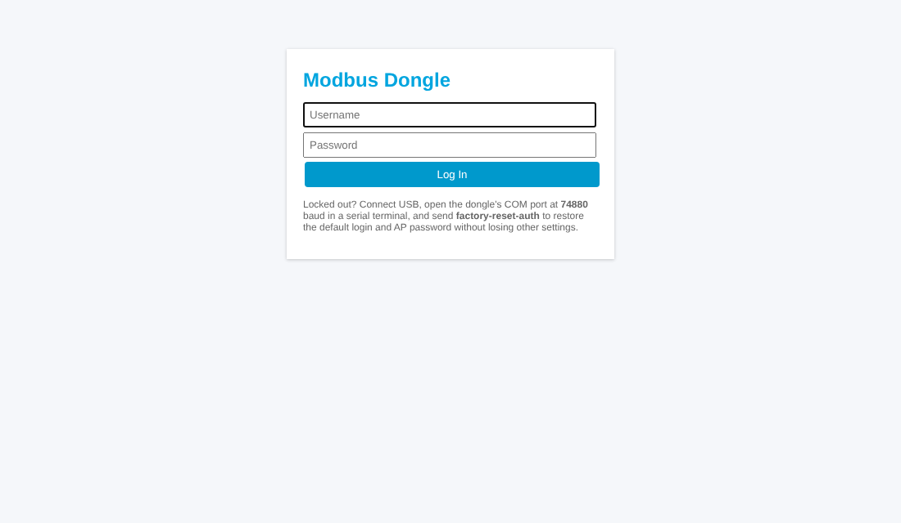
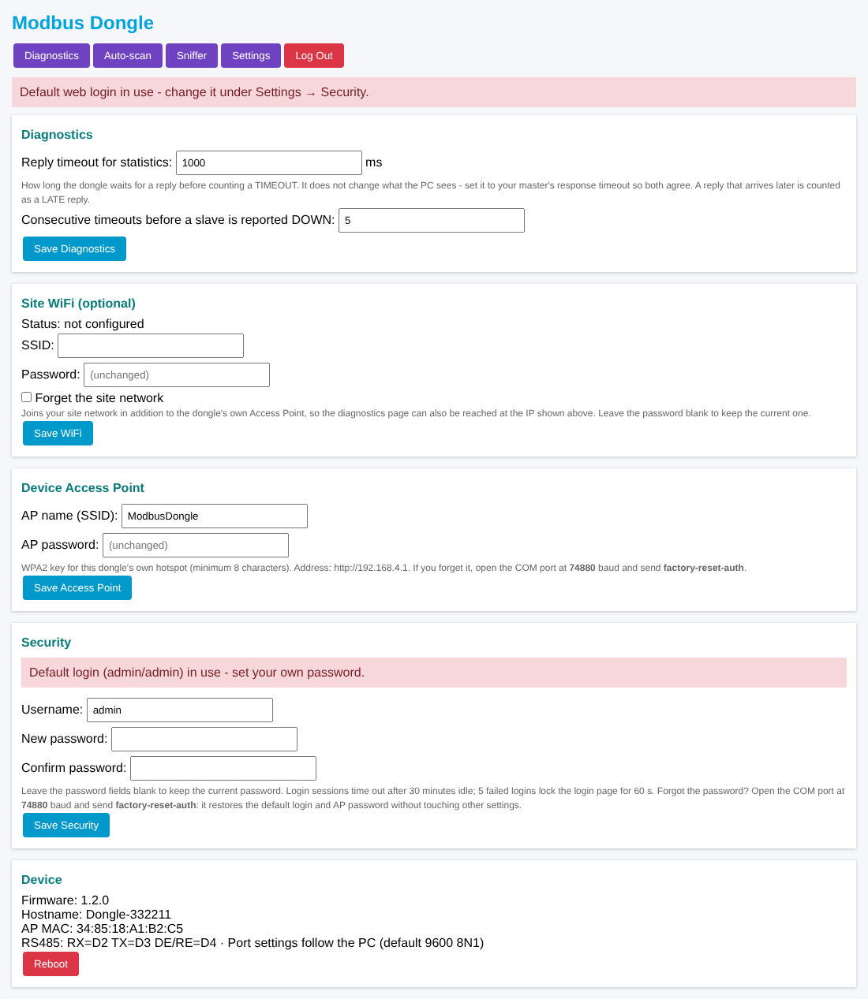
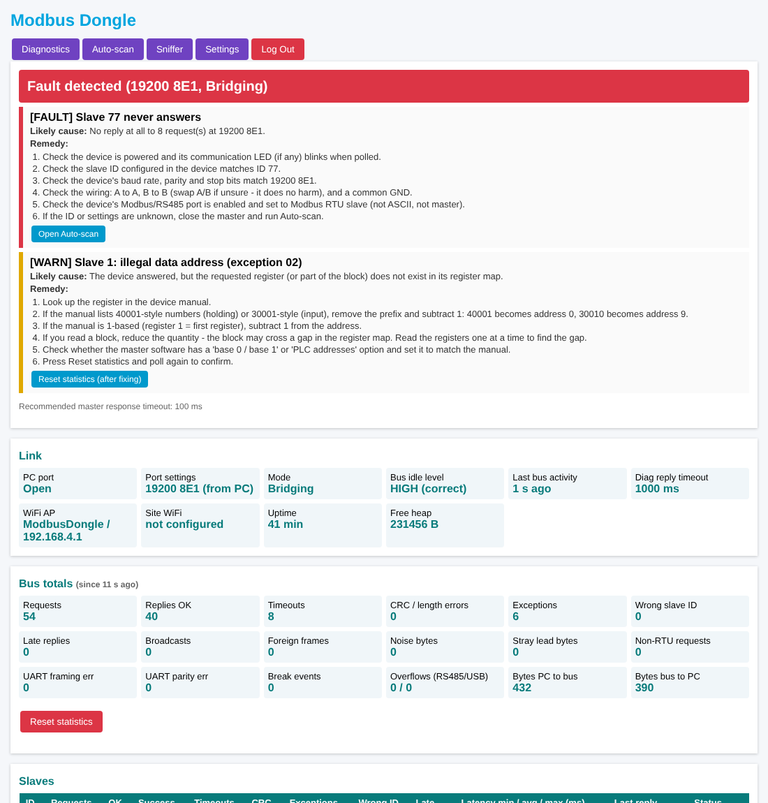
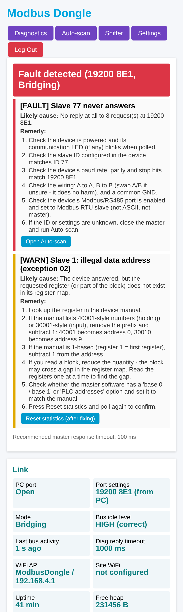
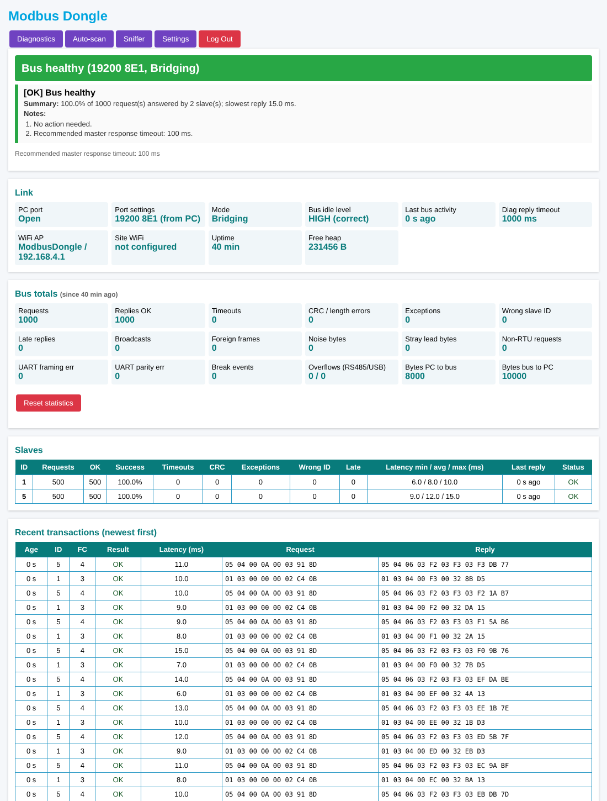
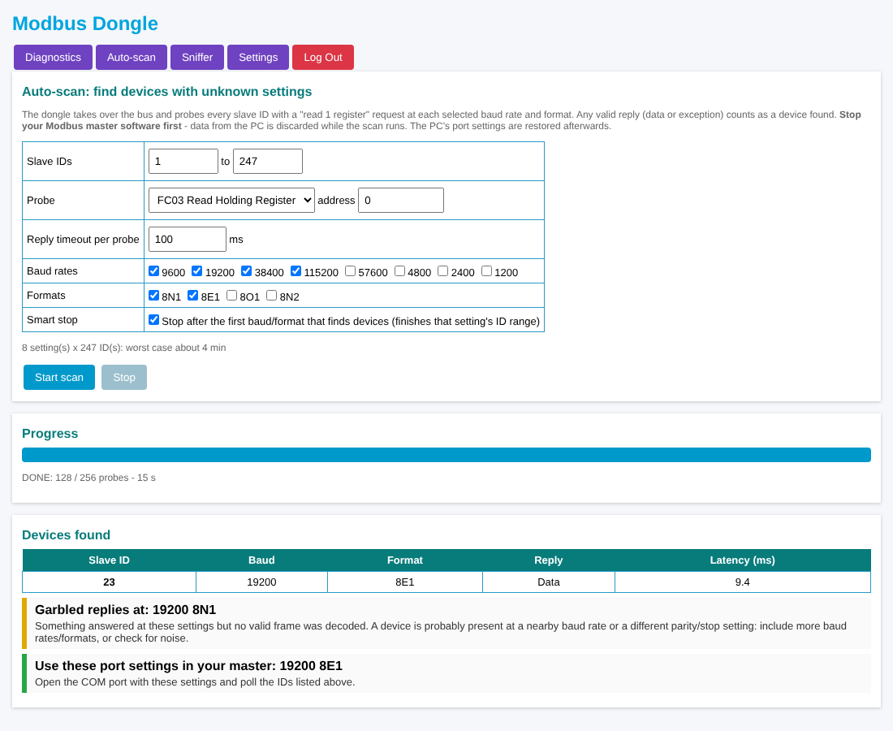
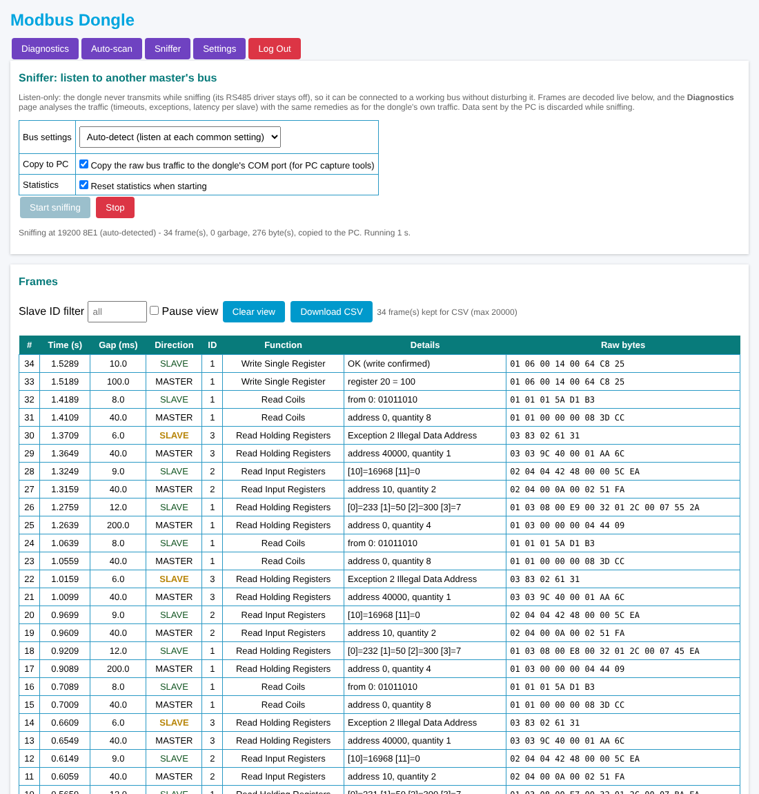
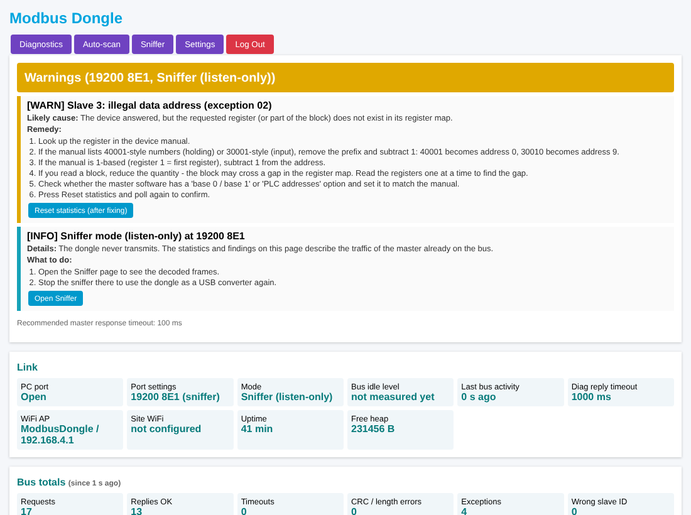

# SOP: Testing the USB-RS485 Dongle on a Raspberry Pi

This standard operating procedure takes you from plugging the dongle into a
Raspberry Pi to a fully tested unit. It covers the converter, the diagnostics,
auto-scan, the sniffer and credential recovery, all from a Pi terminal. Each
step names the matching test ID in [`BENCH_TEST.md`](BENCH_TEST.md) so you can
fill in its results sheet.

> **Just need to know if a dongle is OK?** Run `python3 tools/quick_test.py` (see
> [`QUICK_TEST.md`](QUICK_TEST.md)). This SOP is the full step-by-step procedure.

| Item | Value |
|---|---|
| Applies to | `UsbRs485Dongle` firmware v1.2 or later, Arduino Nano ESP32 on the Gateway board |
| Host | Raspberry Pi 3 / 4 / 5 with Raspberry Pi OS Bookworm (Debian 12) |
| Time needed | About 45 min for steps 1–9, plus about 15 min for the optional steps |

---

## 0. What you need

| # | Item | Notes |
|---|---|---|
| 1 | Raspberry Pi with Raspberry Pi OS (Bookworm), keyboard/screen or SSH | **Use Ethernet for SSH** if you'll connect the Pi's WiFi to the dongle (step 7) |
| 2 | Dongle (Gateway board + Nano ESP32) **already flashed** with the firmware | Flash from your Windows PC with the Arduino IDE as before |
| 3 | USB-C data cable for the dongle | A charge-only cable won't show any port |
| 4 | **A Modbus slave**, either: (a) a real device (meter, VFD, PLC), or (b) a **second USB-RS485 adapter** (e.g. Waveshare) plugged into the Pi, running the simulator `tools/modbus_slave_sim.py` | Option (b) lets the Pi test everything on its own |
| 5 | Twisted pair for A, B and GND; 120 Ω resistor for the sensor end | The dongle end's 120 Ω is on the board |
| 6 | Multimeter | Steps 3.2 and 3.3 |
| 7 | Optional: a second master (another adapter, or a PLC) and a logic analyser | Sniffer step 9 and the DE/RE check |

---

## 1. Prepare the Raspberry Pi (once)

### 1.1 Install the tools
```bash
sudo apt update
sudo apt install -y python3-serial picocom git
sudo apt install -y mbpoll        # optional cross-check tool; skip if apt can't find it
```
> Use the `apt` package `python3-serial` rather than `pip install`. Raspberry
> Pi OS Bookworm blocks system-wide `pip install` (the "externally-managed
> environment" error). The dongle tools need nothing else: `dongle_cli.py` uses
> only the Python standard library.

### 1.2 Allow your user to open serial ports
```bash
sudo usermod -aG dialout $USER
```
**Log out and back in** (or reboot). Check with `groups`: the output must
include `dialout`.

### 1.3 Make sure nothing else grabs the port
ModemManager, if installed, probes every new `ttyACM` device by sending modem
AT commands. **On the dongle those bytes would go out onto the RS485 bus.**
```bash
systemctl is-active ModemManager
```
If it prints `active`, either disable it (`sudo systemctl disable --now
ModemManager`), or keep it and add the udev rule in step 2.4, which tells it
to ignore the dongle.

### 1.4 Get the test tools
```bash
cd ~
git clone -b feature/usb-rs485-dongle https://github.com/brahmadeomk/WeaveShareEquiEsp32Dongle.git
cd WeaveShareEquiEsp32Dongle
ls tools
# dongle_cli.py  modbus_rtu_test.py  modbus_slave_sim.py
```
Once the pull request is merged, use `-b main`. If the Pi has no GitHub access,
copy the `tools` folder over on a USB stick, or use
`scp -r tools pi@<pi-ip>:~/WeaveShareEquiEsp32Dongle/`.

---

## 2. Find the dongle's COM port

On Linux the dongle is not `COM5` but a device file, normally **`/dev/ttyACM0`**.

### 2.1 Watch the kernel log while plugging in
```bash
sudo dmesg --follow
```
Plug the dongle into the Pi. Expect lines like these (numbers vary):
```
usb 1-1.3: New USB device found, idVendor=2341, idProduct=....
usb 1-1.3: Product: Nano ESP32
usb 1-1.3: Manufacturer: Arduino
cdc_acm 1-1.3:1.0: ttyACM0: USB ACM device
```
`idVendor=2341` is Arduino. The last line gives the port name (`ttyACM0`).
Press **Ctrl+C** to stop watching.

**Pass (T3):** a `ttyACMx` line appears. If nothing appears, see the
troubleshooting table in section 11 (charge-only cable, or the board not
flashed).

### 2.2 Use the stable name (recommended)
`ttyACM0` can become `ttyACM1` after a replug or when other adapters are
connected. The `by-id` name never changes:
```bash
ls -l /dev/serial/by-id/
```
Example:
```
usb-Arduino_Nano_ESP32_XXXXXXXXXXXX-if00 -> ../../ttyACM0           <- the dongle
usb-FTDI_FT232R_USB_UART_YYYYYYYY-if00-port0 -> ../../ttyUSB0      <- Waveshare adapter (FT232 version)
usb-1a86_USB_Single_Serial_ZZZZZZ-if00 -> ../../ttyACM1            <- Waveshare adapter (CH343 version)
```
Store both names in shell variables for the rest of this SOP:
```bash
D=$(ls /dev/serial/by-id/*Nano_ESP32* | head -1); echo "Dongle:  $D"
W=$(ls /dev/serial/by-id/* | grep -v Nano_ESP32 | head -1); echo "Adapter: $W"   # only if you use a 2nd adapter
```
> Run these two lines again in every new terminal window.

### 2.3 Quick checks
```bash
lsusb | grep -i 2341        # the Arduino device is listed
ls -l $D                    # group 'dialout', so your user can open it
```

### 2.4 Optional: a fixed name and ModemManager exclusion
```bash
echo 'SUBSYSTEM=="tty", ATTRS{idVendor}=="2341", SYMLINK+="modbus-dongle", ENV{ID_MM_DEVICE_IGNORE}="1"' | \
  sudo tee /etc/udev/rules.d/99-modbus-dongle.rules
sudo udevadm control --reload && sudo udevadm trigger
```
Replug the dongle. It's now also available as `/dev/modbus-dongle`.

### 2.5 FTDI adapters only: reduce USB latency
FTDI-based adapters hold received bytes for up to 16 ms by default, which
slows every reply. If the adapter is a `ttyUSBx`:
```bash
cat /sys/bus/usb-serial/devices/ttyUSB0/latency_timer          # 16 by default
echo 1 | sudo tee /sys/bus/usb-serial/devices/ttyUSB0/latency_timer
```
(This resets on replug.)

---

## 3. Wire the bus and check it electrically

### 3.1 Wiring
```
 Raspberry Pi ──USB── DONGLE                          SENSOR END
                      [120 Ω on board] A ───────────── A ┐  slave device, or
                                       B ───────────── B ┴  [120 Ω: fit it]   2nd adapter (ttyUSB0)
                                     GND ───────────── GND                    ──USB── Raspberry Pi
```
Fail-safe bias goes at one point on the bus: **330 Ω** from A to +5 V and
**330 Ω** from B to GND.

### 3.2 Termination check (P4b): power OFF
Unplug all power and USB. Measure the resistance between A and B at the dongle:

| Reading | Verdict |
|---|---|
| **About 50–65 Ω** | **Pass:** both ends are terminated |
| About 100–120 Ω | Sensor-end 120 Ω missing: fit it |
| Below about 45 Ω | Too many terminators: switch off the ones in the middle |

### 3.3 Idle voltage check (P5): power ON, no traffic
Plug everything back in. Don't run any test yet. Measure A (red lead) to B (black lead):

| Reading | Verdict |
|---|---|
| **+0.3 V to +0.8 V** (typically about +0.7 V) | **Pass** |
| +0.2 to +0.3 V | Marginal: check for extra bias or termination |
| Below +0.2 V | Bias missing |
| Negative | A and B swapped |
| Above about +1 V | Termination missing |

### 3.4 Check the port stays quiet (T5)
```bash
timeout 10 cat $D | xxd | head
```
**Pass:** no output for 10 s. The dongle never prints boot or debug text on its
data port.

---

## 4. Start the slave

**Option (a), a real device:** note its slave ID, baud rate and parity from its
display or manual.

**Option (b), the simulator on the second adapter** (leave it running in its
own terminal):
```bash
cd ~/WeaveShareEquiEsp32Dongle
python3 tools/modbus_slave_sim.py $W --baud 9600 --parity N --slave 1
```
Expected:
```
Simulating slave ID(s) 1 on /dev/serial/by-id/usb-FTDI_... at 9600 8N1 - Ctrl+C to stop
```
The simulator serves holding registers `0,1,2,...`, input registers
`1000,1001,...` and coils `0,1,0,1,...`. Register addresses from 100 up answer
**exception 02**. Each request it answers is printed as `RX ... -> TX ...`.

---

## 5. Converter tests (F1–F5)

Run these in a second terminal (remember to set `D` and `W` again, see 2.2).

### 5.1 First read (F1)
```bash
cd ~/WeaveShareEquiEsp32Dongle
python3 tools/modbus_rtu_test.py $D --baud 9600 --parity N --slave 1 --fc 3 --addr 0 --count 2 --repeat 10
```
Expected (with the simulator; the times vary):
```
[1] TX 01 03 00 00 00 02 c4 0b
    RX 01 03 04 00 00 00 01 3b f3  (12.6 ms)
    registers 0..1: [0, 1]
...
10/10 OK
```
**Pass:** `10/10 OK`, and the values match the device (with the simulator:
`[0, 1]`). The dongle LED flickers **blue** (send) / **green** (receive).
If it fails, go to section 11.

### 5.2 Other reads (F2–F5)
```bash
python3 tools/modbus_rtu_test.py $D --slave 1 --fc 4 --addr 10 --count 3          # F2: [1010, 1011, 1012]
python3 tools/modbus_rtu_test.py $D --slave 1 --fc 3 --addr 9999                  # F3: "slave exception code 2"
python3 tools/modbus_rtu_test.py $D --slave 77 --timeout 0.5                      # F4: BAD/NO RESPONSE
python3 tools/modbus_rtu_test.py $D --slave 1 --count 125 --repeat 5              # F5: needs >=125 registers (real device, or sim --regs 200)
```

### 5.3 Optional: cross-check with mbpoll
```bash
mbpoll -m rtu -a 1 -b 9600 -P none -t 4 -0 -r 0 -c 2 -1 $D
```
`-t 4` reads holding registers. `-0 -r 0` means address 0 as sent on the wire.
**Without `-0`, mbpoll counts from 1** (address 1 = the first register). This
is the same 0-based vs 1-based confusion that the diagnostics explain for
exception 02.

### 5.4 Port settings matrix (L2–L13): fully automatic with the simulator
For each setting, the script restarts the simulator at that setting and polls
it 20 times through the dongle:
```bash
for s in "9600 N 1" "9600 E 1" "9600 O 1" "9600 N 2" "19200 E 1" "19200 N 1" \
         "38400 N 1" "57600 N 1" "115200 N 1" "4800 N 1" "2400 N 1"; do
  set -- $s
  python3 tools/modbus_slave_sim.py $W --baud $1 --parity $2 --stop $3 --quiet & SIM=$!
  sleep 1
  printf '%-7s 8%s%s : ' $1 $2 $3
  python3 tools/modbus_rtu_test.py $D --baud $1 --parity $2 --stop $3 --repeat 20 --quiet --timeout 0.5 | tail -1
  kill $SIM; wait $SIM 2>/dev/null
done
```
**Pass:** every line ends with `20/20 OK`. (Stop the simulator from section 4
first: only one program can use `$W` at a time.)

**Negative check (L13):** run the simulator at 9600 **E**1 and test at 9600 **N**1.
It must **fail**:
```bash
python3 tools/modbus_slave_sim.py $W --baud 9600 --parity E --quiet & SIM=$!; sleep 1
python3 tools/modbus_rtu_test.py $D --baud 9600 --parity N --repeat 5 --timeout 0.3 --quiet | tail -1   # expect 0/5 OK
kill $SIM
```

### 5.5 Soak test (R1)
```bash
python3 tools/modbus_slave_sim.py $W --baud 19200 --parity E --quiet & SIM=$!; sleep 1
time python3 tools/modbus_rtu_test.py $D --baud 19200 --parity E --count 10 --repeat 5000 --timeout 0.5 --quiet
kill $SIM
```
**Pass:** at least `4995/5000 OK`; ideally `5000/5000 OK`. Only failures are
printed, so a clean run shows just the summary line.

---

## 6. Credential recovery console (W12, W13)
Close every program that uses `$D`, then:
```bash
picocom -b 74880 --echo $D
```
Type `status` and press Enter. Expected:
```
Firmware      : 1.2.0
Uptime        : 812 s
Access Point  : ModbusDongle  http://192.168.4.1
Site WiFi     : not configured
Web login     : admin (default password)
Health        : OK
Requests 5040  OK 5040  Timeouts 0  CRC 0  Exceptions 0
```
- `factory-reset-auth` restores the web login (admin/admin) and the AP
  password (12345678), then reboots. Run it only for W12.
- Leave picocom with **Ctrl+A, then Ctrl+X**.
- Opening the port at 74880 baud puts the dongle in console mode, and nothing
  is bridged (W13). The next program that opens the port at a normal baud rate
  switches it back.
- **Never open the dongle's port at 1200 baud.** That reboots it into the
  bootloader (the Arduino upload "touch"). If it happens, unplug and replug.

---

## 7. Connect the Pi to the dongle's web page (W1–W5)

Choose **one** way:

**A. Another device (simplest):** connect a phone or laptop to the WiFi
**ModbusDongle** (password `12345678`) and open **http://192.168.4.1**.

**B. The Pi itself (needed for `dongle_cli.py`):**
```bash
nmcli dev wifi list | grep ModbusDongle
sudo nmcli dev wifi connect ModbusDongle password 12345678 ifname wlan0
curl -s -o /dev/null -w "%{http_code}\n" http://192.168.4.1/login      # expect 200
```
> This moves the Pi's WiFi to the dongle: an SSH session over WiFi will drop,
> so use Ethernet or a local keyboard. To go back afterwards, run
> `sudo nmcli con up "<your normal WiFi name>"`.

**C. Through your site network:** on the web page, open Settings → Site WiFi,
enter your network and save. The page then shows the dongle's IP, which you
can also get from the console `status` (section 6). Use `--host <that IP>`
with the CLI.

Then:
1. Open **http://192.168.4.1**. The login page appears. Log in with **admin / admin** (W3).

   

2. Click **Settings**. While the factory login is in use, red banners say
   *Default web login in use*. Under **Security**, enter a new password twice
   and click **Save Security** (W4). Use it from now on:
   ```bash
   export DONGLE_PASSWORD='your-new-password'
   ```
   The same page holds:
   - the diagnostic reply timeout (needed for D10)
   - the site WiFi network (connection option C above)
   - the Access Point name and password
   - the firmware version and a Reboot button

   

3. Log out and enter a wrong password 5 times. The login page shows *Too many
   failed attempts - locked for 60 seconds* (W5).

**The menu** at the top of every page:

| Button | Page | SOP step |
|---|---|---|
| Diagnostics | Health verdict, findings with remedies, link status, bus totals, slave table, recent transactions, status log. Refreshes every 2 s | 8 |
| Auto-scan | Find devices with unknown ID, baud rate or parity | 9 |
| Sniffer | Listen-only decoding of another master's bus | 10 |
| Settings | Diagnostics timeouts, site WiFi, Access Point, password, reboot | 7 |
| Log Out | End the session (sessions also end after 30 min idle) | - |

---

## 8. Diagnostics tests (W7, W8, D1–D13)

### 8.1 Read the diagnosis from the Pi
```bash
python3 tools/dongle_cli.py reset          # clear old statistics
python3 tools/dongle_cli.py diag           # one-shot
python3 tools/dongle_cli.py diag --watch 5 # refresh every 5 s (Ctrl+C to stop)
```
Example output during a fault:
```
HEALTH: FAULT    bus 9600 8N1  mode Bridging  idle level HIGH (correct)
Requests 54  OK 40  timeouts 8  CRC 0  exceptions 6  wrong ID 0  late 0  foreign 0
Recommended master response timeout: 100 ms
------------------------------------------------------------------------------
[FAULT] Slave 7 never answers
        Likely cause: No reply at all to 8 request(s) at 9600 8N1.
        Remedy 1. Check the device is powered and its communication LED (if any) blinks when polled.
               2. Check the slave ID configured in the device matches ID 7.
               ...
  ID      Req       OK  Success  Timeout    CRC Exceptions Latency min/avg/max ms  Status
   1       46       40   100.0%        0      0      6 (2)        8.0 / 8.0 / 8.0  EXCEPTIONS
   7        8        0     0.0%        8      0          0                      -  NO REPLY
```

**The same finding on the web page:** open **Diagnostics** in the browser. The
coloured bar gives the verdict: green = healthy, yellow = warnings, red =
fault. Each finding has its cause, a numbered remedy, and a button for the
next action (here *Open Auto-scan*, or *Reset statistics (after fixing)*).



On a phone the same page stacks into one column:



### 8.2 Healthy baseline (D1, W8)
Start the simulator at 9600 N1 (section 4), run `dongle_cli.py reset`, then
repeat the soak test (5.5) at 9600 N1 while `diag --watch 5` runs in another
terminal.

**Pass:**
- `HEALTH: OK` and the finding *Bus healthy*
- Requests equal the script's total, and OK equals the script's OK count
- Idle level `HIGH (correct)`
- The soak test still passes, so the diagnostics don't disturb bridging (W8)

What a healthy bus looks like. Check these on the page:
- the green *Bus healthy* bar
- Port settings as set by the PC, and *Bus idle level HIGH (correct)*
- zero in every error box under Bus totals
- each slave at 100 % with its latency
- *OK* rows under Recent transactions



### 8.3 Deliberate faults
Run `dongle_cli.py reset` before each one. Then make the fault, poll, and run
`dongle_cli.py diag`.

| Test | Make the fault | Poll command | Expected finding |
|---|---|---|---|
| **D2** Wrong ID | none | `modbus_rtu_test.py $D --slave 77 --repeat 5 --timeout 0.5` | **[FAULT] Slave 77 never answers** + checklist |
| **D3** Wrong baud | sim at `--baud 19200` | `modbus_rtu_test.py $D --baud 9600 --repeat 5 --timeout 0.5` | **[FAULT] never answers** / **every reply is corrupted**, pointing to Auto-scan |
| **D4** Wrong parity | sim at `--parity E` | `modbus_rtu_test.py $D --parity N --repeat 5 --timeout 0.5` | As D3, naming `9600 8N1` |
| **D5** A/B swapped | swap A/B at the dongle | none; wait 5 s | **[FAULT] RS485 bus idles LOW**; A-B now reads about -0.3 to -0.8 V |
| **D6** Device stops | sim running | start `modbus_rtu_test.py $D --repeat 200 --interval 0.2 --timeout 0.5 --quiet`, press **Ctrl+C on the simulator** halfway | **[FAULT] Slave 1 stopped responding** |
| **D7** Illegal address | sim running | `modbus_rtu_test.py $D --addr 9999 --repeat 3` | **[WARN] illegal data address (exception 02)** with the 40001 / 0-based remedy |
| **D10** Slow slave | sim with `--delay 300`; web Settings → Diagnostics reply timeout = 100 ms | `modbus_rtu_test.py $D --repeat 25 --timeout 1 --quiet` | **[FAULT] Slave 1: every reply arrives too late**, with the remedy to raise the master and diagnostic timeouts. *Recent transactions* on the web page show LATE REPLY rows. Set the reply timeout back to 1000 ms afterwards |
| **D12** Not RTU | none | `printf 'hello\r\n' > $D` | **[INFO] PC traffic is not Modbus RTU** |

For each finding, apply the remedy, run `dongle_cli.py reset`, poll again and
confirm that the finding is gone.

---

## 9. Auto-scan (S1–S9)

Nothing else may use `$D` during a scan (no test script, no picocom).

### 9.1 Find a known device (S1)
```bash
python3 tools/modbus_slave_sim.py $W --baud 9600 --parity N --slave 1 --quiet & SIM=$!
python3 tools/dongle_cli.py scan --from 1 --to 32
```
Expected:
```
DONE         ...   probes ...
Devices found:
  ID   1    9600 8N1  data  latency 8.2 ms
Use these port settings in your master: 9600 8N1
```

### 9.2 Find unknown settings (S2)
```bash
kill $SIM
python3 tools/modbus_slave_sim.py $W --baud 19200 --parity E --slave 23 --quiet & SIM=$!
python3 tools/dongle_cli.py scan --from 1 --to 32
kill $SIM
```
**Pass:** `ID 23   19200 8E1`. The settings tried before it may be listed
under *Garbled replies at*.

The other scan tests (S3–S9) run the same way.

**The same scan on the web page:** open **Auto-scan**, set the ID range, baud
rates and formats, and click **Start scan**. When it's done, the page lists the
devices found, the settings that gave garbled replies, and the port settings
to use in your master:



---

## 10. Sniffer (SN1–SN11)

The sniffer needs **a master and a slave already talking**, with the dongle
listening. With a Pi you can set this up as:
- a real slave plus the Waveshare adapter as the master, or
- two extra adapters: one running the simulator (slave), one running
  `modbus_rtu_test.py` (master).

Example with a real slave at 19200 8E1, ID 1, and the adapter as master:
```bash
# terminal 1 - the "other master": polls once a second for 10 minutes
python3 tools/modbus_rtu_test.py $W --baud 19200 --parity E --slave 1 --repeat 600 --interval 1 --quiet

# terminal 2 - the dongle listens
python3 tools/dongle_cli.py sniff-start --auto      # or: --baud 19200 --fmt E1
python3 tools/dongle_cli.py sniff-show
```
Expected after a few seconds:
```
--- sniffer RUNNING 19200 8E1 (auto-detected)
    5.1023     1000.0  MASTER  ID   1 FC  3  01 03 00 00 00 01 84 0A
    5.1101        7.8  SLAVE   ID   1 FC  3  01 03 02 00 00 B8 44
```

**Pass:**
- **SN1:** terminal 1 keeps reporting no failures while the dongle sniffs. The
  dongle LED blinks cyan.
- **SN4:** the status changes from DETECTING to `RUNNING 19200 8E1 (auto-detected)` within about 10 s.
- **SN7:** run `dongle_cli.py diag` and check it shows *Sniffer mode
  (listen-only)* and slave 1 with 100 % success.
- **SN3 (logic analyser):** D4 stays LOW for the whole session.

**The same on the web page:** open **Sniffer**, choose *Auto-detect* (or the
settings), and click **Start sniffing**. The status line shows the detected
settings. The table decodes every frame:
- **MASTER** rows: the requests
- **SLAVE** rows: the replies, with register addresses and values
- yellow rows: exceptions
- `?` rows: garbage

Use the slave ID filter, **Pause view** and **Download CSV** (SN9) as needed.



While sniffing, **Diagnostics** analyses the other master's traffic (SN7). Here
it flags the PLC reading a register that slave 3 doesn't have:



**Copy to PC (SN8).** With copy-to-PC on (the default), the raw bus bytes also
arrive on the dongle's port:
```bash
stty -F $D raw -echo 9600 && timeout 10 xxd -c 16 $D
```
`xxd` shows the raw request and reply bytes. Don't use 74880 or 1200 baud
here (section 6).

**CSV (SN9):** use the web page Sniffer → Download CSV.

Stop the sniffer and check normal bridging comes back (SN10):
```bash
python3 tools/dongle_cli.py sniff-stop
python3 tools/modbus_rtu_test.py $D --baud 19200 --parity E --repeat 10 --quiet   # 10/10 OK (simulator/real slave at 19200 8E1)
```

---

## 11. Troubleshooting on the Pi

| Symptom | Cause | Fix |
|---|---|---|
| No `ttyACM` line in `dmesg` | Charge-only USB cable, or the board isn't running the firmware | Use a data cable, re-flash from the PC |
| `Permission denied: '/dev/ttyACM0'` | User isn't in `dialout` | Step 1.2, then log out and in |
| `Device or resource busy` / `could not exclusively lock port` | Another program has the port open (picocom, the test script, ModemManager) | `sudo fuser -v $D` shows who; close it, or step 1.3 |
| Port name changes (`ttyACM0` ↔ `ttyACM1`) | Order of plugging | Use `/dev/serial/by-id/...` (step 2.2) or `/dev/modbus-dongle` (2.4) |
| Port disappears after opening at 1200 baud | 1200-baud bootloader touch | Unplug/replug; never use 1200 baud |
| `error: externally-managed-environment` | `pip install` on Bookworm | `sudo apt install python3-serial` instead |
| Every request `BAD/NO RESPONSE`, the LED flashes blue only | Wiring, ID, baud or parity, or the simulator isn't running | `dongle_cli.py diag` shows the finding and remedy. Check A-B voltage (3.3) |
| Replies about 16 ms slower than expected through the adapter | FTDI latency timer | Step 2.5 |
| Dongle resets or disconnects under load | Pi USB power | Use the official Pi power supply; `vcgencmd get_throttled` should print `0x0` |
| `dongle_cli.py`: *Cannot reach 192.168.4.1* | Pi not on the dongle's WiFi | Step 7 B, or use `--host <site IP>` |
| `dongle_cli.py`: *Login failed* | Password changed | `--password ...` or `export DONGLE_PASSWORD=...`; recovery in section 6 |
| Scan or sniff "refused" | The other mode is running, or the 74880 console is open | `dongle_cli.py sniff-stop`, close picocom |

---

## 12. Record the results

Fill in the results sheet in [`BENCH_TEST.md` section 13](BENCH_TEST.md#13-results-record):

| SOP step | Bench test IDs |
|---|---|
| 2 | T3 |
| 3 | P4b, P5, T5 |
| 5 | F1–F5, L2–L13, R1 |
| 6 | W12, W13 |
| 7 | W1–W5 |
| 8 | W7, W8, D1–D13 |
| 9 | S1–S9 |
| 10 | SN1–SN11 |

Save the outputs as evidence:
```bash
python3 tools/dongle_cli.py diag > diag_$(date +%F).txt
```
